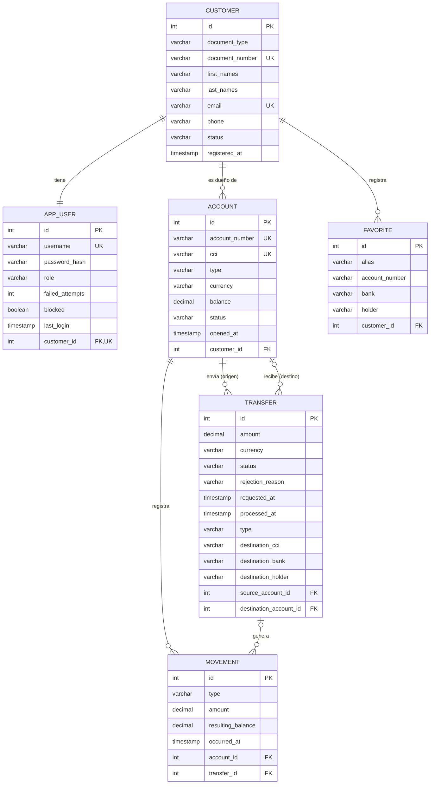

# Mini-Bank-App: rama `microservicios`

## ¿Qué es MiniBank?

MiniBank es un banco digital pequeño. Permite que una persona se registre como cliente, abra sus cuentas y maneje su dinero desde la aplicación, sin ir a una agencia.

Con MiniBank un cliente puede:

- **Registrarse** con su documento de identidad, nombre, correo y teléfono.
- **Ingresar a la app** con su usuario y contraseña. Si se equivoca varias veces seguidas, su acceso se bloquea para protegerlo.
- **Tener una o varias cuentas** en soles o en dólares, cada una con su número de cuenta y su CCI.
- **Transferir dinero** a otras cuentas de MiniBank o de otros bancos.
- **Guardar beneficiarios**, es decir, las cuentas a las que envía dinero seguido, para no escribir los datos cada vez.
- **Ver sus movimientos**: cada ingreso y cada salida de dinero queda registrado con el saldo que quedó después.

El proyecto está hecho con **Spring Boot** y sigue una **arquitectura hexagonal**. En esta rama, `microservicios`, el monolito se divide en tres servicios con un API Gateway y un Config Server delante.

## Arquitectura

```text
                        Cliente (Postman, curl, front)
                                   │  solo habla con :8080
                                   ▼
                     api-gateway :8080  ── rutas, X-Request-Id, Bearer obligatorio, CORS
            ┌──────────────────────┼───────────────────────┐
            ▼                      ▼                       ▼
   auth-service :8081    customer-service :8082    account-service :8083
   usuarios, login,      clientes, favoritos,      cuentas, transferencias,
   registro, firma JWT   /admin/customers          movimientos
            │   ▲               │   ▲                      │
            │   └── Feign ──────┘   │   GET /users/me (Retry + Circuit Breaker + fallback)
            └────── Feign ──────────┘   POST /internal/customers (registro, token de servicio)
            ▼                      ▼                       ▼
         auth_db              customer_db              account_db        (un MySQL, una base por servicio)

   config-server :8888 ── sirve config-repo/ a los cuatro de arriba al arrancar
```

| Proyecto | Puerto | Base de datos | Qué hace |
|---|---|---|---|
| [`api-gateway`](api-gateway/) | 8080 | — | punto único de entrada; enruta sin reescribir paths |
| [`auth-service`](auth-service/) | 8081 | `auth_db` | registro, login, firma del JWT, `GET /users/me` |
| [`customer-service`](customer-service/) | 8082 | `customer_db` | clientes, CRUD de favoritos, `/admin/customers` |
| [`account-service`](account-service/) | 8083 | `account_db` | cuentas, transferencias y movimientos |
| [`config-server`](config-server/) | 8888 | — | configuración de todos desde [`config-repo/`](config-repo/) |

No hay `pom.xml` padre ni código compartido: cada proyecto lleva su propia copia de lo común en el paquete `common` (errores, JWT, logs de llamadas), como en TaskHub. Versiones: **Spring Boot 4.0.9**, **Spring Cloud 2025.1.4**, **Resilience4j 2.4.0** y **JJWT 0.12.6**. Boot 4.1 no tiene todavía un Spring Cloud estable.

## Seguridad

1. `auth-service` firma un JWT HS256 de 30 minutos con los claims `sub`, `roles` y `customerId`, en `/auth/login` y `/auth/register`. Es el único que **firma**.
2. El gateway solo exige `Authorization: Bearer ...` fuera de `/auth/**` y responde 401 si falta. **No** lee el token.
3. Cada servicio valida firma y caducidad con el **mismo** `JWT_SECRET` (`JwtParser`, con JJWT) y construye el usuario (`JwtPrincipal`) solo con los claims; decide roles y propiedad. Un acceso directo a un servicio, sin pasar por el gateway, sigue protegido.
4. Errores de seguridad, siempre en el mismo formato `ErrorResponse` (`status`, `message`, `details`, `timestamp`), igual que el resto de errores y que los del gateway:
   - **401**: sin token, token inválido o caducado (con `WWW-Authenticate: Bearer`), o credenciales incorrectas en el login.
   - **403**: rol insuficiente (`/admin/**` exige `ADMIN`) o usuario bloqueado.
   - **404**: un recurso de otro cliente, sin confirmar que existe.
5. `/internal/**` es solo para llamadas entre servicios: exige el rol `SERVICE` y el gateway no tiene ruta hacia él.

Contrapartidas conocidas: con un secreto compartido, quien valida también podría firmar (con RSA, solo `auth-service` tendría la clave privada), y un token sigue valiendo hasta que caduca.

## Llamadas entre servicios (OpenFeign)

| Quién llama | A quién | Cuándo | Si falla |
|---|---|---|---|
| auth-service | customer-service `POST /internal/customers` | registro: crea el cliente antes que el usuario, con un token de servicio de 60 s (rol `SERVICE`) | 409 si el documento o el email ya existen; cualquier otro fallo, 503, y no se crea el usuario |
| customer-service | auth-service `GET /users/me` | crear un favorito: ¿el usuario sigue activo? Reenvía el token del usuario | ver resiliencia |

Las llamadas van directas al servicio, sin pasar por el gateway, y llevan `X-Request-Id` (el de la petición original) y `X-Caller-Service` (quién llama). Cada salto deja una línea de log en los **dos** lados; con el id se sigue una petición de punta a punta:

```text
api-gateway      | POST /favorites -> 201 CREATED en 112 ms [18b95f29-...]
customer-service | [customer-service -> auth-service] GET /users/me [req=18b95f29-...]
auth-service     | [auth-service <- customer-service] GET /users/me -> 200 en 9 ms [req=18b95f29-...]
customer-service | [customer-service <- auth-service] 200 en 31 ms (GET /users/me)
```

El gateway borra `X-Caller-Service` de las peticiones externas: un cliente no puede hacerse pasar por un servicio en los logs.

## Resiliencia: auth-service caído

La llamada de `customer-service` a `auth-service` está protegida, por este orden, con **Retry( Circuit Breaker( Feign con timeouts ) )** y un **fallback**. Los parámetros están en `config-repo/customer-service.properties`:

| Pieza | Valor |
|---|---|
| Timeout | conexión 1 s, lectura 2 s |
| Retry | 2 intentos, 300 ms entre ellos; solo para 5xx y fallos de conexión |
| Circuit Breaker | ventana de 10 llamadas, mínimo 5; abre con el 50 % de fallos, 10 s abierto y 3 llamadas de prueba |
| Respuestas | activo → favorito verificado · bloqueado → 403 · inexistente → 404 · **sin respuesta → fallback** |

Si `auth-service` está caído, lento, fallando o con el circuito abierto, el fallback acepta el favorito con `"ownerVerified": false`: el token firmado ya prueba la identidad, y rechazar todas las altas mientras auth está caído sería peor. Las lecturas no dependen de `auth-service`. Login y registro, que sí dependen de él, responden 503 desde el gateway. Cada cambio de estado del circuito queda en el log. Límite conocido: nadie reverifica después los favoritos no verificados.

La llamada se hace **fuera de una transacción**, para no retener una conexión de la base mientras se espera a otro servicio.

## Configuración (Config Server)

`config-server` sirve [`config-repo/`](config-repo/): `application.properties` para todos, y un archivo base y otro `-dev` por proyecto. Ahí están puertos, URLs de las bases y de los servicios, rutas del gateway, timeouts, parámetros de resiliencia y ubicaciones de Flyway. Los **secretos no**: `JWT_SECRET`, `DB_USERNAME` y `DB_PASSWORD` llegan del entorno (`.env`), y `ConfigServerTest` falla si aparece uno en `config-repo`.

Al arrancar, cada servicio escribe de dónde sacó su configuración:

```text
Configuración cargada desde: config-server (perfiles activos: [dev], puerto: 8082)
```

Si dice `local`, el Config Server no respondió y el servicio arrancó con los valores de respaldo de su `application.properties`. El gateway no tiene respaldo para sus rutas: sin Config Server no enruta nada. Para ver lo que recibe un servicio: `curl localhost:8888/customer-service/dev`.

## Migraciones (Flyway)

- `db/migration/V*.sql`: el esquema; se aplica siempre. `customer-service` tiene una `V2` que añade `favorite.owner_verified`.
- `db/seed/R__seed_dev_data.sql`: los datos de prueba; solo con el **perfil `dev`**. Así los usuarios de prueba nunca llegan a producción.

## Modelo de datos (ERD)

Las líneas que cruzan de servicio (`CUSTOMER` con `APP_USER` y con `ACCOUNT`) ya no son claves foráneas: son ids que se respetan por convención. El registro crea el cliente y el usuario con el mismo id de cliente.



## Arrancar

Requisitos: Java 21 y Docker.

```bash
cp .env.example .env                 # una sola vez; cambia JWT_SECRET y DB_PASSWORD (y DB_PORT si el 3307 está ocupado)
docker compose up -d                 # MySQL con auth_db, customer_db y account_db
```

Después, en este orden y cada uno en su terminal. Los servicios, con el perfil `dev`:

```bash
cd config-server && ./mvnw spring-boot:run                                      # 1. :8888, primero
cd auth-service && ./mvnw spring-boot:run -Dspring-boot.run.profiles=dev        # 2. :8081
cd customer-service && ./mvnw spring-boot:run -Dspring-boot.run.profiles=dev    # 3. :8082
cd account-service && ./mvnw spring-boot:run -Dspring-boot.run.profiles=dev     # 4. :8083
cd api-gateway && ./mvnw spring-boot:run                                        # 5. :8080, el único que usa el cliente
```

En IntelliJ: *Active profiles* = `dev` en los tres servicios. Sin `dev`, las tablas se crean vacías y el login no encuentra usuarios.

> El script que crea las bases solo corre con el volumen vacío. Si ya tenías el volumen de otra prueba: `docker compose down -v && docker compose up -d` (borra los datos).

Tests: H2 en memoria y servicios falsos, sin Docker ni Config Server. Cada servicio incluye `ArchitectureTest` (ArchUnit), que comprueba la arquitectura hexagonal y las fronteras entre servicios.

```bash
for s in config-server api-gateway auth-service customer-service account-service; do (cd $s && ./mvnw test); done
```

## Endpoints (todos por el gateway, `http://localhost:8080`)

| Método | Ruta | Acceso | Servicio | Descripción |
|---|---|---|---|---|
| POST | `/auth/register` | público | auth (+ customer) | Crea cliente y usuario; devuelve un token |
| POST | `/auth/login` | público | auth | Devuelve un token |
| GET | `/favorites` | cliente | customer | Mis favoritos |
| POST | `/favorites` | cliente | customer (+ auth) | Crear; verifica el usuario con auth-service |
| GET | `/favorites/{id}` · `/favorites/alias/{alias}` | dueño | customer | Detalle (404 si es de otro) |
| PUT | `/favorites/{id}` | dueño | customer | Modificar (404 si es de otro) |
| DELETE | `/favorites/{id}` | dueño | customer | Borrar (404 si es de otro) |
| GET | `/admin/customers` | `ADMIN` | customer | Todos los clientes con su estado |
| POST | `/transfers` | dueño de la cuenta | account | Transferir |
| GET | `/transfers/{id}` · `/transfers?accountId=` | dueño | account | Transferencias |
| GET | `/movements/{id}` · `/movements?accountId=` | dueño | account | Movimientos |

Usuarios de prueba (perfil `dev`): `demo/demo123`, `admin/admin123` (rol ADMIN), `maria/maria123`, `pedro/pedro123` (bloqueado).

```bash
TOKEN=$(curl -s -X POST localhost:8080/auth/login -H 'Content-Type: application/json' \
  -d '{"username":"demo","password":"demo123"}' | python3 -c 'import sys,json;print(json.load(sys.stdin)["token"])')
curl localhost:8080/favorites -H "Authorization: Bearer $TOKEN"
```

La colección [sc/minibank.postman_collection.json](sc/minibank.postman_collection.json) recorre el flujo completo por el gateway.

## Comprobación de punta a punta

Con todo levantado, [`scripts/smoke-test.sh`](scripts/smoke-test.sh) recorre la lista por el gateway: Config Server, registro y login, 401 y 403, admin, CRUD de favoritos solo del dueño, Feign y cuentas.

```bash
scripts/smoke-test.sh                # con todo arriba: 25 comprobaciones
scripts/smoke-test.sh auth-caido     # después de parar auth-service: login 503, favorito aceptado sin verificar, lecturas OK
```

## Pendiente

Dockerfile por servicio, Compose con todo el sistema y pipeline de CI, como en las clases 12 y 13 de TaskHub.
