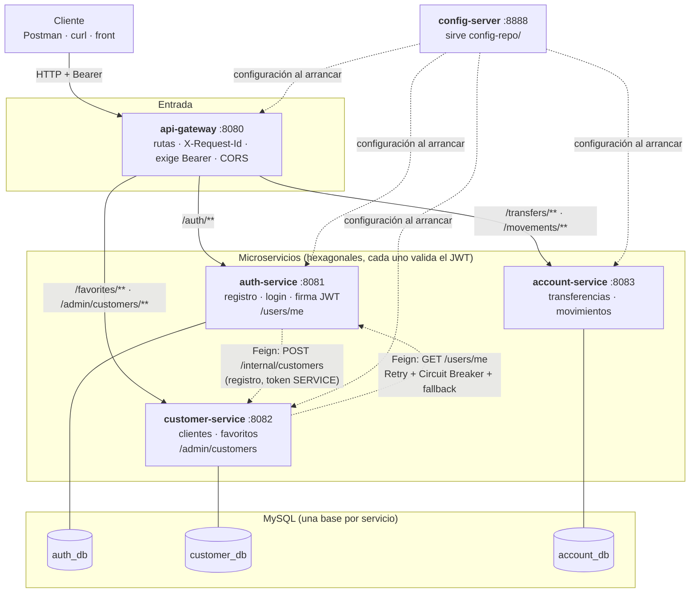
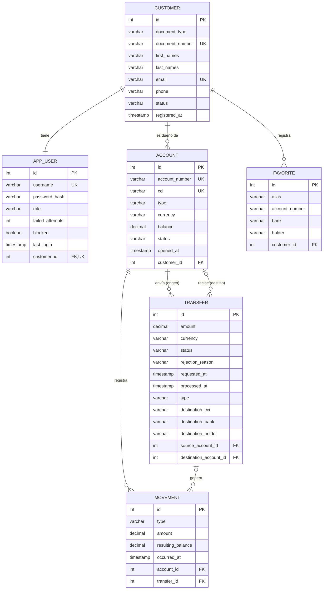

# MiniBank: rama `microservicios`

## Descripción

MiniBank es un banco digital pequeño, hecho como proyecto de práctica de **Spring Boot**. Un cliente se registra, inicia sesión y, desde la app, consulta su dinero, transfiere y guarda las cuentas a las que paga seguido.

Qué puede hacer un cliente:

- **Registrarse** con su documento de identidad, nombres, correo, teléfono, usuario y contraseña. Recibe un token JWT y queda con sesión iniciada.
- **Iniciar sesión** con usuario y contraseña. Un usuario bloqueado no puede entrar (403).
- **Transferir dinero** desde una de sus cuentas, en soles o dólares, a un CCI de MiniBank (transferencia interna) o de otro banco (externa).
- **Consultar sus transferencias y movimientos**: cada ingreso y cada salida queda registrado con el saldo resultante.
- **Gestionar sus favoritos** (alta, consulta por id o alias, edición y baja): las cuentas a las que transfiere seguido. Solo ve y toca los suyos.

Un **administrador** puede, además, listar todos los clientes con su estado.

Las cuentas de prueba vienen en los datos semilla del perfil `dev`; la API no abre cuentas nuevas.

Esta rama divide el monolito original en **tres microservicios** con **arquitectura hexagonal**, más un **API Gateway** como única puerta de entrada y un **Config Server** que reparte la configuración. Cada servicio tiene su propia base de datos y se comunican entre ellos con **OpenFeign**, protegido con **Resilience4j**.

## Arquitectura



- Las flechas continuas son el tráfico del cliente; **todo** entra por el gateway (`:8080`).
- Las punteadas son llamadas directas entre servicios (Feign), que **no** pasan por el gateway.
- `/internal/**` no tiene ruta en el gateway: un cliente nunca puede llamarlo.

| Proyecto | Puerto | Base de datos | Qué hace |
|---|---|---|---|
| [`api-gateway`](api-gateway/) | 8080 | — | punto único de entrada; enruta sin reescribir paths |
| [`auth-service`](auth-service/) | 8081 | `auth_db` | registro, login, firma del JWT, `GET /users/me` |
| [`customer-service`](customer-service/) | 8082 | `customer_db` | clientes, CRUD de favoritos, `/admin/customers` |
| [`account-service`](account-service/) | 8083 | `account_db` | transferencias y movimientos |
| [`config-server`](config-server/) | 8888 | — | configuración de todos desde [`config-repo/`](config-repo/) |

Cada servicio sigue la misma estructura hexagonal: `domain` (modelo y reglas, sin Spring), `application` (casos de uso con puertos `port.in` / `port.out`) e `infrastructure` (controladores, JPA, Feign, seguridad). `ArchitectureTest` (ArchUnit) hace cumplir esas fronteras.

No hay `pom.xml` padre ni código compartido: cada proyecto lleva su propia copia de lo común en el paquete `common` (errores, JWT, logs de llamadas), como en TaskHub. Versiones: **Java 21**, **Spring Boot 4.0.9**, **Spring Cloud 2025.1.4**, **Resilience4j 2.4.0**, **JJWT 0.12.6**, **Flyway** y **MySQL 8**. Boot 4.1 no tiene todavía un Spring Cloud estable.

## APIs expuestas

Todas por el gateway: `http://localhost:8080`. Salvo login y registro, todas necesitan `Authorization: Bearer <token>`.

| Método | Ruta | Acceso | Servicio | Descripción | Respuestas |
|---|---|---|---|---|---|
| POST | `/auth/register` | público | auth (+ customer) | Crea el cliente y su usuario; devuelve un token | 201 · 400 · 409 · 503 |
| POST | `/auth/login` | público | auth | Inicia sesión; devuelve un token | 200 · 400 · 401 · 403 |
| GET | `/favorites` | cliente | customer | Lista mis favoritos | 200 · 401 |
| POST | `/favorites` | cliente | customer (+ auth) | Crea un favorito; verifica el usuario con auth-service | 201 · 400 · 403 · 404 · 422 |
| GET | `/favorites/{id}` | dueño | customer | Detalle de un favorito | 200 · 404 |
| GET | `/favorites/alias/{alias}` | dueño | customer | Busca un favorito por alias | 200 · 404 |
| PUT | `/favorites/{id}` | dueño | customer | Modifica un favorito | 200 · 400 · 404 · 422 |
| DELETE | `/favorites/{id}` | dueño | customer | Borra un favorito | 204 · 404 |
| GET | `/admin/customers` | `ADMIN` | customer | Todos los clientes con su estado | 200 · 403 |
| POST | `/transfers` | dueño de la cuenta | account | Transfiere desde una cuenta propia a un CCI | 201 · 400 · 404 · 422 |
| GET | `/transfers/{id}` | dueño | account | Detalle de una transferencia | 200 · 404 |
| GET | `/transfers?accountId={id}` | dueño | account | Transferencias de una cuenta | 200 · 404 |
| GET | `/movements/{id}` | dueño | account | Detalle de un movimiento | 200 · 404 |
| GET | `/movements?accountId={id}` | dueño | account | Movimientos de una cuenta | 200 · 404 |

"Dueño" significa que el recurso debe ser del cliente del token; si es de otro, la respuesta es **404**, sin confirmar que existe. Cualquier ruta protegida sin token devuelve **401** desde el gateway. Significado de los códigos: **400** datos inválidos · **401** sin token o credenciales incorrectas · **403** rol insuficiente o usuario bloqueado · **404** no existe o no es tuyo · **409** documento o correo ya registrados · **422** regla de negocio (saldo insuficiente, monedas distintas, alias repetido...) · **503** auth-service o customer-service no disponible.

**Internas** (no expuestas por el gateway, solo entre servicios):

| Método | Ruta | Servicio | Quién la llama | Acceso |
|---|---|---|---|---|
| POST | `/internal/customers` | customer | auth-service, en el registro | rol `SERVICE` (token de servicio de 60 s) |
| GET | `/users/me` | auth | customer-service, al crear un favorito | token del usuario, reenviado |

Usuarios de prueba (perfil `dev`): `demo/demo123`, `admin/admin123` (rol ADMIN), `maria/maria123`, `pedro/pedro123` (bloqueado).

```bash
TOKEN=$(curl -s -X POST localhost:8080/auth/login -H 'Content-Type: application/json' \
  -d '{"username":"demo","password":"demo123"}' | python3 -c 'import sys,json;print(json.load(sys.stdin)["token"])')
curl localhost:8080/favorites -H "Authorization: Bearer $TOKEN"
```

La colección [sc/minibank.postman_collection.json](sc/minibank.postman_collection.json) recorre el flujo completo por el gateway.

## Seguridad

1. `auth-service` firma un JWT HS256 de 30 minutos con los claims `sub`, `roles` y `customerId`, en `/auth/login` y `/auth/register`. Es el único que **firma**.
2. El gateway solo exige `Authorization: Bearer ...` fuera de `/auth/**` y responde 401 si falta. **No** lee el token.
3. Cada servicio valida firma y caducidad con el **mismo** `JWT_SECRET` (`JwtParser`, con JJWT) y construye el usuario (`JwtPrincipal`) solo con los claims; decide roles y propiedad. Un acceso directo a un servicio, sin pasar por el gateway, sigue protegido.
4. Errores de seguridad, siempre en el mismo formato `ErrorResponse` (`status`, `message`, `details`, `timestamp`), igual que el resto de errores y que los del gateway:
   - **401**: sin token, token inválido o caducado (con `WWW-Authenticate: Bearer`), o credenciales incorrectas en el login.
   - **403**: rol insuficiente (`/admin/**` exige `ADMIN`) o usuario bloqueado.
   - **404**: un recurso de otro cliente, sin confirmar que existe.
5. `/internal/**` es solo para llamadas entre servicios: exige el rol `SERVICE` y el gateway no tiene ruta hacia él.

Contrapartidas conocidas: con un secreto compartido, quien valida también podría firmar (con RSA, solo `auth-service` tendría la clave privada), y un token sigue valiendo hasta que caduca.

El gateway borra `X-Caller-Service` de las peticiones externas: un cliente no puede hacerse pasar por un servicio en los logs.

## Configuración (Config Server)

`config-server` sirve [`config-repo/`](config-repo/): `application.properties` para todos, y un archivo base y otro `-dev` por proyecto. Ahí están puertos, URLs de las bases y de los servicios, rutas del gateway, timeouts, parámetros de resiliencia y ubicaciones de Flyway. Los **secretos no**: `JWT_SECRET`, `DB_USERNAME` y `DB_PASSWORD` llegan del entorno (`.env`), y `ConfigServerTest` falla si aparece uno en `config-repo`.

Al arrancar, cada servicio escribe de dónde sacó su configuración:

```text
Configuración cargada desde: config-server (perfiles activos: [dev], puerto: 8082)
```

Si dice `local`, el Config Server no respondió y el servicio arrancó con los valores de respaldo de su `application.properties`. El gateway no tiene respaldo para sus rutas: sin Config Server no enruta nada. Para ver lo que recibe un servicio: `curl localhost:8888/customer-service/dev`.

## Migraciones (Flyway)

- `db/migration/V*.sql`: el esquema; se aplica siempre. `customer-service` tiene una `V2` que añade `favorite.owner_verified`.
- `db/seed/R__seed_dev_data.sql`: los datos de prueba; solo con el **perfil `dev`**. Así los usuarios de prueba nunca llegan a producción.

## Modelo de datos (ERD)

Las líneas que cruzan de servicio (`CUSTOMER` con `APP_USER` y con `ACCOUNT`) ya no son claves foráneas: son ids que se respetan por convención. El registro crea el cliente y el usuario con el mismo id de cliente.



## Arrancar

### Todo en Docker

Requisitos: solo Docker. Un comando construye las cinco imágenes y levanta todo en orden, por healthchecks:

```bash
cp .env.example .env                                  # una sola vez; cambia JWT_SECRET y DB_PASSWORD
docker compose --profile app up -d --build --wait     # MySQL, config-server, 3 servicios y gateway
docker compose --profile app ps                       # todos "healthy"
scripts/smoke-test.sh                                 # comprobación de punta a punta por el gateway
```

- Cada proyecto tiene su `Dockerfile` (dos etapas: JDK para compilar, JRE para ejecutar, sin root). La imagen no ejecuta los tests.
- Los servicios arrancan con los perfiles `dev,docker`. `config-repo/*-docker.properties` cambia `localhost` por los nombres de servicio de Compose (`mysql:3306`, `http://auth-service:8081`...); `dev` carga los datos de prueba.
- `config-repo/` se monta en el Config Server: tras cambiar un valor, `docker compose restart <servicio>`.
- Los secretos salen del `.env`, igual que en local.
- Logs: `docker compose logs -f customer-service auth-service`. Para probar la resiliencia: `docker compose stop auth-service` y `scripts/smoke-test.sh auth-caido`.
- Parar: `docker compose --profile app down` (con `-v` borra también los datos).

## Pendiente

Pipeline de CI como la ultima clase del bootcamp
